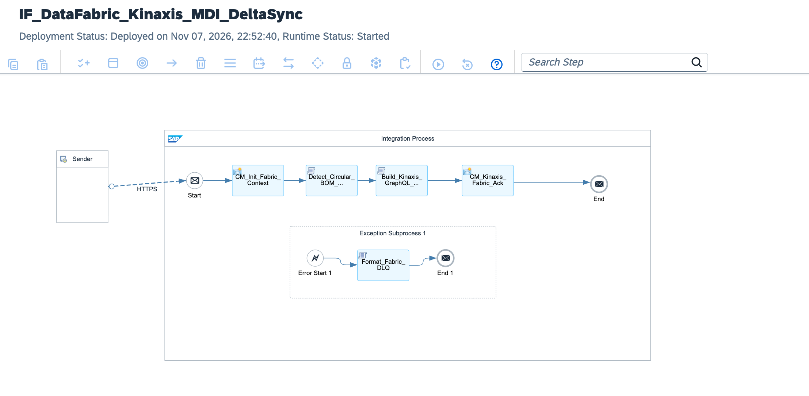

# Enterprise Supply Chain Data Fabric: SAP MDI to Kinaxis Maestro GraphQL Streaming

[](https://www.sap.com)
[](https://www.sap.com)
[](https://www.kinaxis.com)
[](https://graphql.org)
[](https://www.sap.com)

---

## Executive Summary

Global manufacturers and supply chain enterprises synchronise millions of bill-of-material (BOM) revisions, plant assignments, and part master updates between SAP S/4HANA and advanced planning platforms such as Kinaxis Maestro. Classical monolithic batch exports trigger JVM heap overflow (Out-Of-Memory) exceptions in integration runtimes and corrupt downstream MRP runs when circular dependency loops occur.

This architecture establishes a **Resilient Enterprise Supply Chain Data Fabric**:
1. **Event-Driven Master Data Delta Sync:** Consumes SAP Master Data Integration (MDI) One Domain Model (ODM) delta streams directly, processing only modified records.
2. **In-Flight BOM Cycle Detection (DFS Algorithm):** Parses assembly graph dependencies in-memory using a recursive Depth-First Search algorithm to detect circular references (e.g., Component A ──► Component B ──► Component A) before they reach the planning solver.
3. **GraphQL Cursor-Based Micro-Batching:** Streams cleansed master data in chunks of 250 records to the Kinaxis Maestro GraphQL mutation endpoint using Base64-encoded cursor tokens (`pageInfo`, `endCursor`).
4. **Circuit Breaker Resilience:** Quarantines cyclic structures and stream timeouts to a dedicated Dead-Letter Queue (DLQ) without blocking pipeline throughput.

---

## Architecture Overview



### High-Level Topology

```text
[SAP S/4HANA Cloud / SAP MDI (One Domain Model)]
          │
          │ Event-Driven Delta Webhook (/fabric/mdi/masterdata/sync)
          ▼
[SAP Integration Suite: IF_DataFabric_Kinaxis_MDI_DeltaSync]
  │
  ├── 1. Context Initialization (CM_Init_Fabric_Context):
  │    └─ Captures MPL correlation, initializes pagination cursors & metric counters
  │
  ├── 2. Graph Cycle Detection Engine (Detect_Circular_BOM_Dependencies.groovy):
  │    ├─ Constructs in-memory Adjacency List for Bill-of-Materials
  │    ├─ Executes Depth-First Search (DFS) recursion stack
  │    ├─ Quarantines circular BOM loops (alerts X-Fabric-Alert: CIRCULAR_BOM_DETECTED)
  │    └─ Emits sanitized Master Data Fabric payload
  │
  ├── 3. GraphQL Chunking & Mutation Engine (Build_Kinaxis_GraphQL_Payload.groovy):
  │    ├─ Slices cleansed records into micro-batches (chunk size: 250)
  │    ├─ Injects Base64 cursor telemetry (currentCursor, nextCursor, hasMorePages)
  │    └─ Builds OASIS/Kinaxis GraphQL mutation envelope: upsertPartMaster(batch: $input)
  │
  ├── 4. Data Fabric Acknowledgement (CM_Kinaxis_Fabric_Ack) ──► End Message:
  │    └─ Returns audit metrics, parts synchronized, and cursor telemetry
  │
  └── 5. Circuit Breaker Subprocess (Format_Fabric_DLQ.groovy):
       └─ Opens circuit on JVM/parsing failures and dumps incident context to DLQ
```

---

## Technical Specifications

| Dimension | Classical Batch File Integration | Supply Chain Data Fabric (MDI + GraphQL) |
| :--- | :--- | :--- |
| **Data Ingestion** | Monolithic scheduled FTP / CSV dumps | Event-driven change pointer streaming via SAP MDI |
| **Payload Protocol** | Flat relational tables / BAPI calls | Hierarchical GraphQL mutation with cursor pagination |
| **Memory Footprint** | Unbounded JVM heap usage (OOM risks) | Controlled streaming buffers (250 items/batch) |
| **BOM Validation** | Delayed solver failure in Kinaxis | In-flight DFS graph cycle detection in CPI |
| **Network Egress** | Heavy payload over-fetching | Targeted attribute queries via GraphQL schemas |
| **Fault Isolation** | Complete batch rollback on single failure | Partial batch success with atomic DLQ quarantining |

---

## GraphQL Mutation Envelope

```graphql
mutation UpsertPartMasterBatch($input: PartMasterBatchInput!) {
    upsertPartMaster(batch: $input) {
        successCount
        rejectedCount
        pageInfo {
            hasNextPage
            endCursor
        }
    }
}
```

### Dispatched Variable Payload (Micro-Batch)

```json
{
  "query": "mutation UpsertPartMasterBatch($input: PartMasterBatchInput!) { ... }",
  "variables": {
    "input": {
      "clientContext": "SAP_MDI_DELTA_FABRIC",
      "executionTimestamp": "2026-11-07T22:30:00Z",
      "items": [
        {
          "partNumber": "MAT-DRIVE-AXLE-01",
          "description": "Heavy Duty Drive Axle",
          "baseUOM": "PCE",
          "planningPlant": "1010",
          "leadTimeDays": 21,
          "bomComponents": [
            { "componentId": "MAT-BEARING-SUB-01", "quantity": 2.0 },
            { "componentId": "MAT-GEAR-BOX-99", "quantity": 1.0 }
          ]
        }
      ]
    }
  },
  "cursorTelemetry": {
    "currentCursor": "START",
    "nextCursor": "Y3Vyc29yLW9mZnNldC0x",
    "hasMorePages": false,
    "chunkCount": 1
  }
}
```

---

## Repository Structure

```text
├── README.md                                             # Architecture specification & operations runbook
├── sap-cpi-datafabric-kinaxis-runtime-architecture.png   # Integration flow runtime topology diagram
├── ADR-003-DataFabric-MDI-Kinaxis-GraphQL.md             # Architecture Decision Record
├── IF_DataFabric_Kinaxis_MDI_DeltaSync.zip               # Production iFlow runtime bundle export
├── cpi/
│   └── scripts/
│       ├── Detect_Circular_BOM_Dependencies.groovy       # Graph cycle detection engine (DFS)
│       ├── Build_Kinaxis_GraphQL_Payload.groovy          # GraphQL cursor pagination & chunking
│       └── Format_Fabric_DLQ.groovy                      # Circuit breaker dead-letter queue formatter
├── tests/
│   ├── sample_clean_bom_stream.json                      # Valid master data stream test payload
│   └── sample_circular_bom_payload.json                  # Fault test payload with infinite cycle
└── .gitignore                                            # Git exclusion rules
```

---

## Verification & Deployment Runbook

### 1. Inbound Endpoint Verification
Verify runtime status in **Monitor** ──► **Manage Integration Content**:
```text
https://<tenant-runtime>.cfapps.<region>[.hana.ondemand.com/http/fabric/mdi/masterdata/sync](https://.hana.ondemand.com/http/fabric/mdi/masterdata/sync)
```

### 2. Dispatched cURL Test (Happy Path)
Execute an authorized POST request using valid Master Data records:

```bash
curl -X POST \
  'https://<tenant-runtime>.cfapps.<region>[.hana.ondemand.com/http/fabric/mdi/masterdata/sync](https://.hana.ondemand.com/http/fabric/mdi/masterdata/sync)' \
  -H 'Content-Type: application/json' \
  -H 'Authorization: Bearer <BTP_OAUTH_TOKEN>' \
  --data-binary '@tests/sample_clean_bom_stream.json'
```

### 3. Monitoring Trace
* Inspect execution in **Monitor Message Processing**.
* Verify properties `Valid_Materials_Count`, `Total_BOM_Cycles_Detected=0`, and `Next_Page_Cursor`.
* Confirm response payload confirms `dataFabricStatus: SUCCESS_STREAMED_TO_KINAXIS`.

---

## Author

**Željko Popov**  
*Integration Architect | SAP Integration Suite & Clean Core Specialist*  
[GitHub Repositories](https://github.com/neurozeljko)
